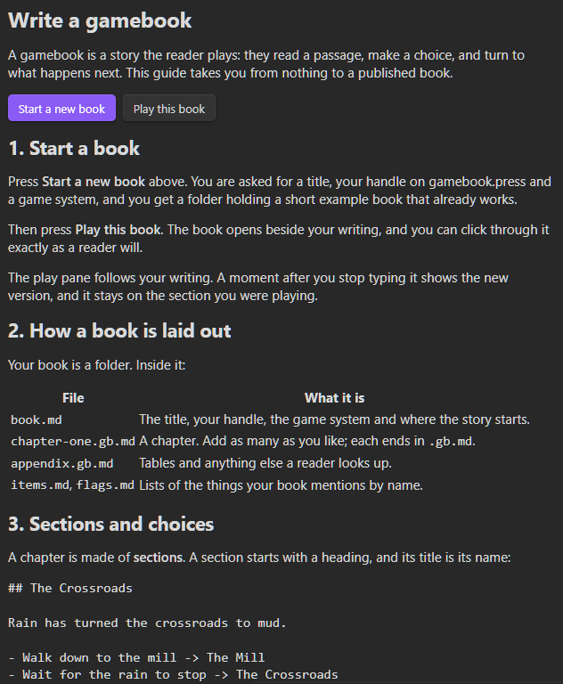

# Gamebook Press

Write a gamebook in Obsidian, play it as you write, and publish it on [gamebook.press](https://gamebook.press).

A gamebook is a story the reader plays: read a passage, make a choice, turn to what happens next. With this plugin your book is a folder of ordinary notes. Sections are headings, choices are list items with an arrow, and the plugin writes the fiddly parts for you.

You do not need to know markdown, and you do not need to know how to code.


## What it does

- **Starts you with a working book.** *Start a new book* makes a short example you can play straight away: a few sections, a locked door, a creature, a table and an ending. Edit it into your own.
- **Plays the book beside your manuscript.** The same engine gamebook.press uses, in a side pane. Items, locked choices, dice, fights and endings behave exactly as your readers will find them.
- **Writes the formatting for you.** Right-click in a chapter to insert:
  - **Read-aloud text**, set apart in a box.
  - **Stat blocks**, laid out the way your game system prints them. Dungeon Crawl Classics, d20 Classic and the Standard Gamebook have their own, and in those the stat block is what the monster fights with; any other system gets a plain one.
  - **Roll tables**, with a row for every result of the dice you pick.
  - **GM's notes**: notes to yourself that show while you write and are never published.
  - **Links to a table or section**, so a reader can look something up and come straight back.
- **Finds your mistakes.** A choice that leads nowhere, an item nobody declared, a section no one can reach: each is listed above the game in plain words. Click one to jump to the line.
- **Lets you leave things unwritten.** Point a choice at `???` and keep going. The book still plays, and the pane keeps the list of what is left.
- **Tells you how hard a fight is.** A fight report fights each fight in your book a few hundred times on its own dice and shows how often the reader wins and what they have left. A path report fights the fights a reader meets one after another.
- **Rolls characters, or a whole band.** In Dungeon Crawl Classics a book can roll the reader's character on a setting instead of offering pre-gens, or hand them a band who step up one after another as each falls. See <https://gamebook.press/docs/systems/dcc>.
- **Builds a contents page** from your headings, for finding your way around a long manuscript.
- **Exports for publishing.** One command makes the file gamebook.press takes.


## What a book looks like

```
## The Crossroads

> [!read-aloud]
> Rain has turned the crossroads to mud. A lantern hangs from the signpost, still lit.

- Take the lantern -> stay here
    gives: the lantern
- Walk down to the mill -> The Mill
- Go inside -> Inside the Mill
    needs: the lantern
    blocked: It is too dark to go in without a light.
```

That is the whole idea. The built-in guide (the graduation-cap icon in the ribbon) walks through the rest, and the full reference is at <https://gamebook.press/docs/writing>. What each game system's checks, saves and fights look like is at <https://gamebook.press/docs/systems>.



## Publish on gamebook.press

Your book can stay a folder on your computer forever. If you want readers, [gamebook.press](https://gamebook.press) publishes gamebooks that play in a browser, on a phone or a laptop, with nothing to install.

- **Your book stays yours.** The words and the art are yours, and the site hands the whole book back as a file whenever you ask.
- **Test before you publish.** Share a private link with friends and playtesters first.
- **Publish when you decide.** The site tells you what still stands between the book and readers, and the button is yours alone to press.

To submit a book: make an account, choose your handle, ask for creator access, run *Export this book as a package*, and upload the file under *Your books → New book*. Step by step: <https://gamebook.press/docs/publishing>.

## Installing

Until the plugin is in Obsidian's community list:

- **By hand.** On the [latest release](https://github.com/Live-to-Role/gamebook-plugin/releases/latest), download the file whose name starts `gamebook-press-` and ends `.zip` (not "Source code"). Unzip it and put the `gamebook-press` folder in `<your vault>/.obsidian/plugins/`, so that `main.js` ends up at `.obsidian/plugins/gamebook-press/main.js`. (Windows may wrap it in a second folder when it unzips; it is the inner one you want.) Then open Settings → Community plugins, press the reload button, and switch on *Gamebook Press*.
- **With [BRAT](https://github.com/TfTHacker/obsidian42-brat).** Add `Live-to-Role/gamebook-plugin` as a beta plugin.

## Commands

| Command | What it does |
|---------|--------------|
| Start a new book | Makes a folder holding a playable example book. |
| Open the writing guide | The step-by-step guide, in the sidebar. |
| Play this book | Opens or closes the play pane on the book you are in. |
| Reload the book | Recompiles the book now. The pane also does this by itself a moment after you stop typing. |
| Insert read-aloud text / GM's note / stat block / roll table | Writes the block at the cursor. |
| Insert link to a table or section | A choice that looks something up and returns. |
| Update the contents page | Rewrites the *Contents* note from your headings. |
| Export this book as a package | Writes `<book id>.gamebook.zip` beside the book. |
| Report on the fights in this book | Fights each fight 200 times as each pre-gen (or as a freshly rolled character or band each time, in a book that rolls them) and shows how often they win and what they have left. In a system with Luck, burning it and keeping it are shown apart where it makes a difference. |
| Report on a path of fights in this book | Fights the fights you pick one after another, each with the wounds the last left. Only the fights are played, not the sections between them, so healing on the way is not counted. In a band book the next member steps up when one falls. |

## Privacy and network use

- The plugin works entirely on your computer. It makes no network requests, collects nothing and has no telemetry.
- No account is needed to write, play or export. An account on gamebook.press is needed only if you choose to publish there, and uploading is something you do yourself on the site.
- It reads and writes only inside your vault: the book's own folder, the exported zip and the *Contents* note.

## Support

Second Person Press is a Magical Mishap LLC creation. Patrons on [Patreon](https://www.patreon.com/c/MagicalMishap) fund the plugin and gamebook.press.

## Licence

MIT. Dungeon Crawl Classics is a trademark of Goodman Games.
