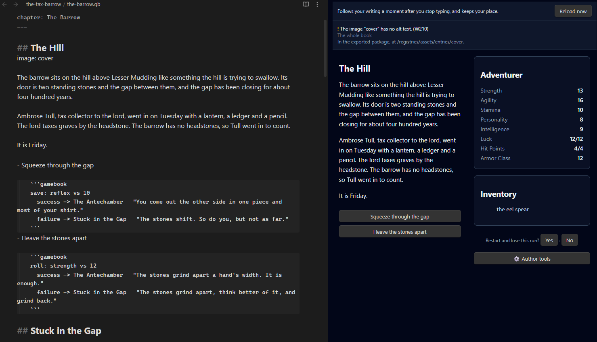
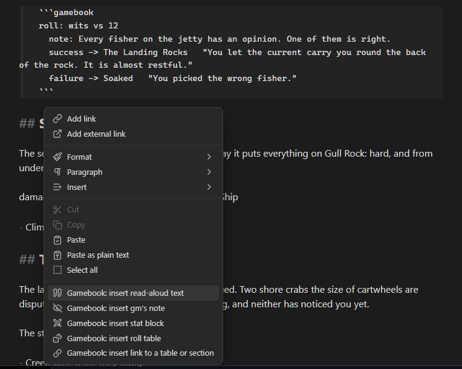

# Gamebook Press

Write a gamebook in Obsidian, play it as you write, and publish it on [gamebook.press](https://gamebook.press).

A gamebook is a story the reader plays. They read a passage, pick what to do, and the book answers. With this plugin the book does the bookkeeping: it rolls the dice, fights the fights, keeps the character sheet and remembers the key they picked up three rooms ago. Your reader just plays.

You write it as a folder of ordinary notes. Sections are headings, choices are list items with an arrow, and the plugin writes the fiddly parts for you. You do not need to know markdown, and you do not need to know how to code.



## What your reader gets

- **A story that answers back.** Every choice goes somewhere you wrote. Doors stay locked until they have the key, and the guard remembers what they said to him.
- **No homework.** A monster is described, never shown as a stat line. A table is rolled out of sight, so the reader just finds whatever is in the room this time. A fight shows how hurt each side is.
- **A different run each time**, when you want one. Tables vary what is in a room; you still decide every way in and out.
- **A map that fills in as they walk**, if your book has one.
- **A book they can hold.** The same book exports for print, numbered and ready to lay out, and as an ebook where "turn to 147" is a link.

## What it does for you

- **Starts you with a working book.** *Start a new book* makes a short example you can play straight away: a few sections, a locked door, a table, its endings, and a fight in any system that has monsters. Edit it into your own.
- **Plays the book beside your manuscript.** The same engine gamebook.press uses, in a side pane. Items, locked choices, dice, fights and endings behave exactly as your readers will find them.
- **Writes the formatting for you.** Right-click in a chapter to insert:
  - **Entries**, with a heading, a place for their words, and their choices.
  - **Items**, added to your list of items and given to the reader where you are writing.
  - **Monsters**, laid out the way your game system prints them and added to your list of monsters, with a fight against them where you are writing. Dungeon Crawl Classics, d20 Classic and the Standard Gamebook have monsters. A reader is told what a monster is like, never its numbers.
  - **Tables**, with a row for every result of the dice you pick, drawn from out of sight when the reader arrives, so an entry plays differently each time.
  - **Keywords**: something the book remembers about the reader, written in words, hidden unless you choose to show it.
  - **Author's notes**: notes to yourself that show while you write and are never published.
- **Finds your mistakes.** A choice that leads nowhere, an item nobody declared, a section no one can reach: each is listed above the game in plain words. Click one to jump to the line.
- **Lets you leave things unwritten.** Point a choice at `???` and keep going. The book still plays, and the pane keeps the list of what is left.
- **Tells you how hard a fight is.** A fight report fights each fight in your book a few hundred times on its own dice and shows how often the reader wins and what they have left. A path report fights the fights a reader meets one after another.
- **Rolls characters, or a whole band.** In Dungeon Crawl Classics a book can roll the reader's character on a setting instead of offering pre-gens, or hand them a band who step up one after another as each falls. See <https://gamebook.press/docs/systems/dcc>.
- **Draws a map.** `map: explored` in book.md, and `area:`, `size:` and `terrain:` on your entries, give readers a map that fills in as they go: rooms and corridors, places outdoors as hexes. It keeps its layout as you write; *Lay out again* moves everything.
- **Builds a contents page** from your headings, for finding your way around a long manuscript.
- **Exports for the site, for print and as an ebook.** One command makes the file gamebook.press takes. Another numbers the entries at random, keeps linked ones apart, and writes an `.idml` to finish in InDesign or Affinity Publisher, with the monsters' numbers, the tables and a character sheet printed for a reader with dice and a pencil. A third writes an `.epub` from the same numbers.



## What a book looks like

```
## The Crossroads

Rain has turned the crossroads to mud. A lantern hangs from the signpost, still lit.

- Take the lantern -> stay here
    gives: the lantern
- Walk down to the mill -> The Mill
- Go inside -> Inside the Mill
    needs: the lantern
    blocked: It is too dark to go in without a light.
```

That is the whole idea. The built-in guide (the graduation-cap icon in the ribbon) walks through the rest, and the full reference is at <https://gamebook.press/docs/writing>. What each game system's checks, saves and fights look like is at <https://gamebook.press/docs/systems>.


## Publish on gamebook.press

Your book can stay a folder on your computer forever. If you want readers, [gamebook.press](https://gamebook.press) publishes gamebooks that play in a browser, on a phone or a laptop, with nothing to install.

- **Your book stays yours.** The words and the art are yours, and the site hands the whole book back as a file whenever you ask.
- **Test before you publish.** Share a private link with friends and playtesters first.
- **Publish when you decide.** The site tells you what still stands between the book and readers, and the button is yours alone to press.

To submit a book: make an account, choose your handle, ask for creator access, run *Export this book as a package*, and upload the file under *Your books → New book*. Step by step: <https://gamebook.press/docs/publishing>.

## Installing

In Obsidian, open Settings → Community plugins. If it offers *Turn on community plugins*, press it first. Then press *Browse*, search for *Gamebook Press*, install it and switch it on. Obsidian keeps it up to date from there. Its page in the directory is <https://community.obsidian.md/plugins/gamebook-press>.

Other ways:

- **By hand**, which does not update itself. On the [latest release](https://github.com/Live-to-Role/gamebook-plugin/releases/latest), download the file whose name starts `gamebook-press-` and ends `.zip` (not "Source code"). Unzip it and put the `gamebook-press` folder in `<your vault>/.obsidian/plugins/`, so that `main.js` ends up at `.obsidian/plugins/gamebook-press/main.js`. (Windows may wrap it in a second folder when it unzips; it is the inner one you want.) Then open Settings → Community plugins, press the reload button, and switch on *Gamebook Press*.
- **With [BRAT](https://github.com/TfTHacker/obsidian42-brat).** Add `Live-to-Role/gamebook-plugin` as a beta plugin.

## Commands

| Command | What it does |
|---------|--------------|
| Start a new book | Makes a folder holding a playable example book. |
| Open the writing guide | The step-by-step guide, in the sidebar. |
| Play this book | Opens or closes the play pane on the book you are in. |
| Reload the book | Recompiles the book now. The pane also does this by itself a moment after you stop typing. |
| Insert entry with choices | A new section, with a `???` where its words go, and its choices. |
| Insert item | Adds the item to `items.md` and gives it to the reader at the cursor. |
| Insert monster | Adds the monster to `monsters.md` and puts a fight against it at the cursor. |
| Insert table | Adds a table to `tables.md` and draws from it at the cursor. |
| Insert entry with a table | A new section that draws from a table. |
| Insert keyword | Picks or makes a keyword, and writes it being gained, text shown only with it, or a choice that needs it. |
| Insert author's note | Writes the note at the cursor. |
| Update the contents page | Rewrites the *Contents* note from your headings. |
| Export this book as a package | Writes `<book id>.gamebook.zip` beside the book. |
| Export this book for print | Writes a `print` folder beside the book: an `.idml` file for InDesign or Affinity Publisher, the map, a report of what does not translate to paper, and layout notes. Entry numbers are kept in `print-numbers.json`. |
| Renumber this book for print | The same, with every entry numbered afresh. |
| Export this book as an ebook | Writes `<book id>.epub` into the same `print` folder, with the same entry numbers, each "turn to" a link. A `cover.jpg`, `.png`, `.webp` or `.svg` beside `book.md` is its cover. |
| Report on the fights in this book | Fights each fight 200 times as each pre-gen (or as a freshly rolled character or band each time, in a book that rolls them) and shows how often they win and what they have left. In a system with Luck, burning it and keeping it are shown apart where it makes a difference. |
| Report on a path of fights in this book | Fights the fights you pick one after another, each with the wounds the last left. Only the fights are played, not the sections between them, so healing on the way is not counted. In a band book the next member steps up when one falls. |

## Privacy and network use

- The plugin works entirely on your computer. It makes no network requests, collects nothing and has no telemetry.
- No account is needed to write, play or export. An account on gamebook.press is needed only if you choose to publish there, and uploading is something you do yourself on the site.
- It reads and writes only inside your vault: the book's own folder, the exported zip, the `print` folder and `print-numbers.json`, and the *Contents* note.

## Support

Second Person Press is a Magical Mishap LLC creation. Patrons on [Patreon](https://www.patreon.com/c/MagicalMishap) fund the plugin and gamebook.press.

## Licence and source code

The plugin is free to use, and closed source: its source code is not published. Obsidian's community directory reads it privately to check that each release is built from it. It is released under the [MIT License](LICENSE).

Dungeon Crawl Classics is a trademark of Goodman Games.
